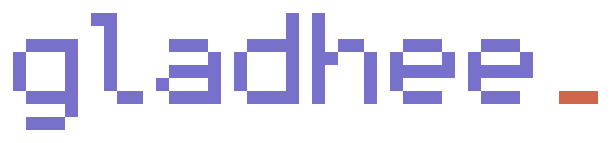

  

  최희성입니다. <a href="https://aiswitch.co.kr/">AI Switch</a>에서 채팅을 개발하고, Kubernetes와 Argo CD로 서비스를 배포합니다.

  <samp><a href="https://aiswitch.co.kr/docs/ko/introduction/admin-overview/">AI Switch 콘솔 문서</a> &nbsp;·&nbsp; <a href="https://kibo-compliance.illusionists1004.workers.dev/">ChatGPT 관리센터 데모 (가상 데이터)</a> &nbsp;·&nbsp; <a href="https://github.com/scrumpled-paper/agiler/pull/129">Agiler 배포 PR</a></samp>

프로젝트 메모

- **AI Switch** · 최근 문답 5쌍과 pgvector로 찾은 과거 문답 5쌍을 현재 질문에 함께 담았습니다. [대화 문맥 구성도](./assets/chat-context.png)
- **여행사 자동견적** · 같은 견적 요청으로 온프레미스 모델을 비교하고, 고객과 엑셀 요금표 자동화 범위를 정했습니다.
- **구매대행 CRM** · Slack과 파일에 흩어진 고객 기록을 모으고 일정과 금액 처리를 자동화했습니다.

