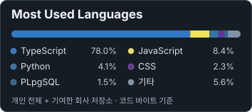

## 최희성 · HeeSung Choi

현업에서는 TypeScript를 주로 씁니다. AI Switch의 채팅과 관리자 콘솔을 개발하고, VM 한 대에서 시작한 서비스를 AWS의 Kubernetes로 확장했습니다.

**42Seoul** · 2023.09 – 2025.06 · [학습 기록](https://github.com/gladhee/42cursus)

### Projects & Consulting

- **AI Switch** · pgvector로 이전 대화를 찾는 채팅과 사용자별 권한·크레딧 관리. [제품](https://aiswitch.co.kr/) · [콘솔 문서](https://aiswitch.co.kr/docs/ko/introduction/admin-overview/)
- **ChatGPT 도입 컨설팅** · 기업·기관의 ChatGPT Business·Enterprise 도입 과정에서 SSO 연동을 지원하고 사용자를 교육했습니다. Enterprise 고객사에는 Compliance API 명세에 맞춰 권한별 기록과 기간별 사용량을 조회하는 관리자 웹을 개발했습니다.

<!-- profile-stats:start -->

  
  

<!-- profile-stats:end -->

업무 자동화 프로젝트

- **여행사 자동견적** · 온프레미스에서 같은 견적 요청으로 모델을 비교하고, 고객과 요금표 자동화 범위를 정했습니다.
- **구매대행 CRM** · 여러 파일과 Slack에 흩어진 고객 기록을 모으고 일정·금액 처리를 자동화했습니다.

