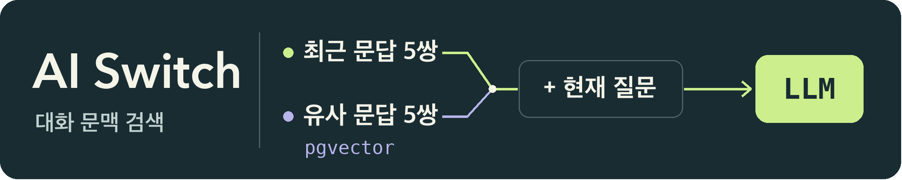

# 최희성

기업용 AI 서비스를 만들고 운영합니다. 여행사와 요금표를 펼쳐 놓고 무엇을 자동화할지 함께 정하는 일을 좋아합니다.

- **AI Switch** · 채팅과 관리자 콘솔을 개발했습니다. 배포와 운영은 혼자 맡아 VM 한 대에서 AWS의 Kubernetes로 확장했습니다.
- **여행사 자동견적** · 실제 견적 요청으로 온프레미스 모델을 비교하고, 엑셀 요금표를 견적 생성에 연결했습니다.
- **구매대행 CRM** · Slack과 파일에 흩어진 고객 기록을 한곳에 모으고 일정과 금액 처리를 자동화했습니다.

[AI Switch 제품](https://aiswitch.co.kr/) · [ChatGPT 관리센터 데모 (가상 데이터)](https://kibo-compliance.illusionists1004.workers.dev/) · [Agiler 배포 PR](https://github.com/scrumpled-paper/agiler/pull/129)
